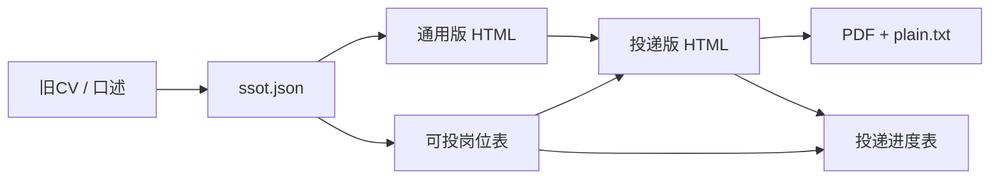

# Agent 路由（唯一权威）

> 设计立场 → [DESIGN.md](DESIGN.md)

## 最小日路径

空仓 / 首次 → 聊经历（walkthrough）→ **通用版 HTML**。  
有通用版 + JD → 投递版。搜可投 / 进度表 / 面试 / 开场 → **按需**再开对应流程。

## 三条 invariant

1. 事实只进 `ssot.json`；JD 包装只进 HTML  
2. 术语走 `term_registry`；`internal` 不上简历；`essential` 保留 ATS 关键词  
3. 争议 → `conflicts`；裁决 → `constraints`；再动简历  

## 数据流



## 工作区（磁盘布局，不对用户报文件名）

```
<workspace>/
├── ssot.json
├── resumes/
│   ├── industry_base.html
│   ├── industry_<jd-slug>.html / .txt
│   ├── academic_base.html
│   ├── academic_<jd-slug>.html / .txt
│   └── <岗目录>/interview-rN-YYYYMMDD.md   # 单岗实战复盘（可选；不进 ssot）
├── offers/                          # 可选：求职漏斗
│   ├── job-match-industry.html      # 可投岗位表（多渠道实搜+审计）
│   ├── application-tracker.html     # 投递进度表
│   ├── offer-comparison.html        # Offer 条件、来源、版本与计算
│   ├── candidate-profile.json       # 求职画像（技能/偏好；扩岗前默认更新）
│   ├── interview-exposure-ledger.md # 跨岗面试暴露台账（可选）
│   └── _scratch/                    # 临时检索；勿对用户堆路径
└── config.json   # 可选，templates/config.example.json
```

对用户称：**经历档案 / 通用版 / 投递版 / 网申文本 / 可投岗位表 / 投递进度表 / 面试准备 / 面试复盘 / 暴露台账**。

## 智能默认

| 信号 | 动作 |
|------|------|
| 首次、工作区空 | 自动复制 starter → 建 `resumes/` |
| 给了旧简历路径 | scan → 若要 JD 则直接 jd（lazy base） |
| 只口述 | walkthrough，3 轮，第 1 轮后出草稿 |
| 新缩写 ≤5 | 内联翻译，跳过 audit-terms |
| 投递版交付 | HTML + 尝试 PDF + `export_plain.py --from-html`；短审计 + 必答追问；有 offers/ 则看板联动（第三方定稿留可投表，实投后进进度表） |
| 第三方岗感兴趣 / 已打招呼 | [job-match.md](workflows/job-match.md) 投递通道：入库 `待确认` → 平台沟通 → `待投递` → 出投递版 → 发简历后进进度表 |
| 只改一句 | [workflows/patch.md](workflows/patch.md)：改 HTML → 最小 ssot 回写 → validate |
| 学术版简历 | `academic` 轨 + `templates/resume-academic.html` |
| 搜可投岗位 / 刷新岗位表 | [workflows/candidate-profile.md](workflows/candidate-profile.md)（步骤 0 默认刷新）→ [workflows/job-match.md](workflows/job-match.md)：脑暴 → 多渠道实搜 → 审计入库 |
| 搜可投 + 招聘网站访问 | [workflows/job-match.md](workflows/job-match.md) step 2: local Chrome first; follow Website access below |
| 总结技能/求职偏好 / 适合投什么 | [workflows/candidate-profile.md](workflows/candidate-profile.md) |
| 无岗位表 | 从 `templates/job-match-board.html` 复制到 `offers/` |
| 同步可投表 / 发来 job-match-state.json | [workflows/job-match.md](workflows/job-match.md)「Agent 同步可投表」 |
| 更新投递 / Offer / 进度表 | [workflows/offer.md](workflows/offer.md) |
| Offer 对比 / 谈薪 / 税前税后 / 社保公积金 / 招聘方方案 | [workflows/offer-comparison.md](workflows/offer-comparison.md) |
| 岗位进入 Offer 阶段（含录用意向） | [workflows/offer-comparison.md](workflows/offer-comparison.md)：主动回查该岗已有复盘、转写及沟通材料，建立或补齐对比表 |
| Offer 阶段新增消息 / 文件 / 复盘 / 员工反馈 | [workflows/offer-comparison.md](workflows/offer-comparison.md)：主动提取与比较维度相关的增量信息，当轮写回对比表 |
| 无进度表 | 从 `templates/application-tracker.html` 复制到 `offers/`（含归档面板 / 停留提醒 / 备注气泡） |
| 岗位定位 / 要点改写 / HR 开场（不要文件） | [workflows/resume.md](workflows/resume.md) Mode · pitch + [rules/resume.md](rules/resume.md) |
| 面试预测 / 追问 / 掌握度 | [workflows/interview.md](workflows/interview.md) |
| 实战面试结束 / 复盘落盘 / 暴露台账 | [workflows/interview.md](workflows/interview.md) Mode · debrief；进度表挂链 → [workflows/offer.md](workflows/offer.md) |
| 无暴露台账 | 从 `templates/interview-exposure-ledger.md` 复制到 `offers/` |
| 用户焦虑 | [README.md](../README.md) FAQ；≤3 问/轮 |

**禁止**：要求用户读 agent 文档；一次丢 >3 路径；对用户说 workflow/schema 名、SSOT、audit、subagent。

## 当前信息复核

更新可投岗位表、投递进度表、Offer 对比看板或关联求职资料时，先读取现值与已有证据，维护一份准确的当前状态，不能只在备注末尾追加消息。单岗更新覆盖该岗的所有关联材料；用户要求更新三个表或全面复核时，检查全部记录及关联资料。

1. **当前名称与归属**：核对实际用人单位、品牌、部门、团队、岗位和工作地。已确认的信息原位替换旧名称、旧猜测及已解决的“待确认”；公司、部门栏不混入平台展示名、招聘渠道或早期联系人所属部门。实际用人单位与签约主体分别依据证据填写。
2. **过时备注与行动**：通读备注、下一步、候补原因、岗位说明及求职画像，清理已被后续事实取代的等待事项、排期和判断。保留有用的日期与依据，将历史过程压缩为清晰的时间线；尚无结果的过期邀约不能推定已完成，面试通过、录用意向和正式方案保持证据层级。
3. **本地资料联动**：检查目录、文件名、页面标题、正文、简历及导出文件是否仍沿用旧称；按已确认身份同步更正。需要改简历时同步 HTML、文本和 PDF，并核对版式。原始录音、截图、邮件、转写及有历史用途的已发送版本保留原貌，明确其日期与用途；必要的历史依据不删除，当前展示不反复夹带已纠正说法。
4. **链接与标识**：重命名前查找引用，完成后更新三个表、画像、复盘及说明页中的路径和链接。保持 immutable id、trackerId、boardId 及实际状态发生时间，不能因名称校正新建重复记录或重置停留计时；写入更新时间并遵守各表已有的浏览器编辑合并规则。
5. **交付前核验**：回读所有修改后的当前字段与资料，搜索旧名称、过时判断和旧路径；逐项判断剩余命中是否属于原始证据或必要历史。验证关联文件及本地链接可达、跨表去重、阶段和统计一致，检查本次修改涉及的页面数据或导出产物。完成标准是已确认信息在所有当前展示中一致，而非新增了一条更正备注。仅凭本地资料核对时，不将外部岗位状态标记为重新验证。

## Website access

- Scope: website reading and interaction for this skill, including job platforms (BOSS Zhipin, Liepin, Zhilian), employer portals, supplied JD links, and recruitment webmail. An explicit user browser or tab selection takes precedence.
- Prefer connected local Google Chrome with the user's existing profile. In Codex, select the Chrome browser control entry (`@Chrome`), rather than the built-in `@Browser` entry. Verify that the available tool can control that browser; installed Chrome alone does not establish a connection.
- Before reading account-dependent content or taking action, check the visible login state and whether the full required content is accessible. If signed out or prompted to log in, remind the user to sign in to that site in the connected Chrome profile. Wait for the user, then verify access again before continuing the affected operation. The user completes passwords, MFA, and CAPTCHA in the browser.
- If Chrome control is unavailable, report the connection issue and ask the user to connect Chrome or provide the JD content. Use another browser or platform MCP/CLI when the user chooses that fallback. An unauthenticated preview is insufficient evidence for a full JD.
- Reuse opened pages and already collected JD details; keep platform requests sequential and limited to the task. Platform MCP/CLI is an optional fallback, not the default search route. On CAPTCHA, rate limiting, or a risk-control warning, stop requests to the affected site and notify the user; do not retry in a loop or switch tools to bypass the restriction. Resume after user resolution and a successful access check.

## 何时读 references（默认不读）

| 条件 | 读 |
|------|-----|
| 商业分析 / 经营分析 / WFM / 增长类经历 | [references/business-analysis-evidence.md](references/business-analysis-evidence.md) |
| 跨会话强主张 / 多岗版本共用基线 | [references/claim-evidence-ledger.md](references/claim-evidence-ledger.md) |
| 用户要邮箱巡检进度 | [references/email-monitoring.md](references/email-monitoring.md) |

## 模式路由

| 意图 | 文档 |
|------|------|
| 新建 | [workflows/init.md](workflows/init.md) + [schema/ssot.md](schema/ssot.md) |
| 改事实 | [workflows/maintain.md](workflows/maintain.md) + [rules/core.md](rules/core.md) |
| 出简历 / 定位开场 / 要点包装 | [workflows/resume.md](workflows/resume.md) + [rules/resume.md](rules/resume.md) |
| 轻量编辑 | [workflows/patch.md](workflows/patch.md) + [rules/resume.md](rules/resume.md) |
| 总结技能/求职偏好 | [workflows/candidate-profile.md](workflows/candidate-profile.md) |
| 搜可投岗位 | [workflows/candidate-profile.md](workflows/candidate-profile.md) + [workflows/job-match.md](workflows/job-match.md) |
| 投递进度 / Offer | [workflows/offer.md](workflows/offer.md) |
| 面试准备 / 实战复盘落盘 | [workflows/interview.md](workflows/interview.md) |
| 从 GitHub 安装 | [INSTALL.md](INSTALL.md) |
| PDF / ATS | [scripts/README.md](../scripts/README.md) |

## 输出

- 自然语言短报；选材表用人话  
- jd 版：[HR 自检](rules/resume.md#hr-自检) + 短审计 + 必答追问 2–3  
- 排版/叙事对照（公开虚构）：[fixtures/example-ssot.json](../fixtures/example-ssot.json) + [example-resume.html](../fixtures/example-resume.html)
- 作者本机私人定稿对照放在**求职工作区**私有目录（如 `_private/`）；**包内不引用、不索取上传**

## 校验命令

```bash
python scripts/validate_ssot.py <ssot.json>
python scripts/render_resume.py --in <html> [--preview-dir <dir>]
python scripts/export_plain.py --from-html resumes/<slug>.html --in ssot.json --out resumes/<slug>.txt
python tests/test_scripts.py
```
